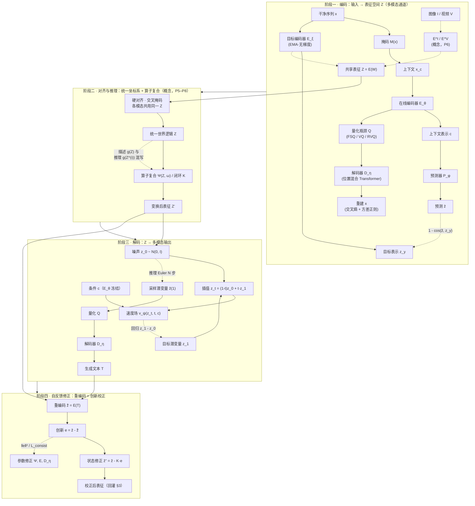

# Flow Matching + JEPA 字符模型：端到端四阶段架构与数学基础（含核心命题验证）

> 本文按「端到端四阶段流水线」组织：**阶段一编码（§2）→ 阶段二对齐与推理（§3）→ 阶段三解码（§4）→ 阶段四自反馈修正（§5）**。§2.2（JEPA 表征学习）与 §4（Flow Matching / 解码）的公式与 [`flow_matching_jepa.py`](file:///home/simon-ma/JEPA/flow_matching_jepa.py) 的实现逐式对齐，行号引用指向该文件；§2.1、§2.6、§3 引入的 $W, I, V, Y, \phi, M, \Omega, \Psi, E^I, E^V, E^A, R_I, R_V, R_A, K, e_t$ 是概念量，对应 [`plan`](file:///home/simon-ma/JEPA/.trae/plan_mosaic_text_unified_lossy_channel.md) 的 P1–P8，本脚本暂不实现。

---

## 0. 符号表与源码映射

| 数学符号 | 含义 | 源码对应 |
|---|---|---|
| $x, x_c, x_y$ | 干净 token 序列、掩码上下文、干净目标 | `clean`, `context_ids`；掩码比例见 [L394-L399](file:///home/simon-ma/JEPA/flow_matching_jepa.py#L394-L399) |
| $E_\theta$ | 在线编码器（接收梯度） | `model.online`，[L352](file:///home/simon-ma/JEPA/flow_matching_jepa.py#L352) |
| $E_\xi$ | 目标编码器（仅 EMA 更新） | `model.target`，[L353](file:///home/simon-ma/JEPA/flow_matching_jepa.py#L353) |
| $P_\phi$ | JEPA 潜变量预测器 | `model.jepa_predictor`，[L357-L361](file:///home/simon-ma/JEPA/flow_matching_jepa.py#L357-L361) |
| $v_\psi$ | Flow Matching 速度场预测器 | `model.flow`，[L370](file:///home/simon-ma/JEPA/flow_matching_jepa.py#L370) |
| $D_\eta$ | 潜变量→token 解码器（位置混合 Transformer + 线性头） | `model.decoder`，`Decoder` |
| $\mu$ | EMA 衰减系数 | `EMA_DECAY=0.99`，[L28](file:///home/simon-ma/JEPA/flow_matching_jepa.py#L28) |
| $L$ | 序列长度 / token 数 | `SEQ_LEN=24`，[L24](file:///home/simon-ma/JEPA/flow_matching_jepa.py#L24) |
| $d$ | 潜空间维度 | `DIM=32`，[L26](file:///home/simon-ma/JEPA/flow_matching_jepa.py#L26) |
| $\mathcal{V}$ | 输出词表（不含 `[MASK]`） | 输出有效词表 $|\mathcal{V}|=77$；`vocab_size=len(chars)+1=78` 含输入专用 `[MASK]`（[L658](file:///home/simon-ma/JEPA/flow_matching_jepa.py#L658)） |
| $z_0, z_1, z_t$ | 噪声、干净潜变量、时刻 $t$ 插值 | `noise`, `target`, `z_t`，[L497-L499](file:///home/simon-ma/JEPA/flow_matching_jepa.py#L497-L499) |
| $u_t$ | 真实速度场 | `velocity_target`，[L500](file:///home/simon-ma/JEPA/flow_matching_jepa.py#L500) |
| $W$ | 世界状态 | 概念量，本脚本不实现 |
| $I, V$ | 图像 / 视频连续观测 | 概念量，本脚本不实现 |
| $Y$ | 跨模态共享语义因子 | 概念量，可由跨模态对齐或线性探针估计 |
| $g$ | 文本量化器 $Z \mapsto \mathcal{V}^L$ | `generate` 的 argmax 解码，[L560-L569](file:///home/simon-ma/JEPA/flow_matching_jepa.py#L560-L569) |
| $\mathcal{F}_t$ | 文本 $t$ 对应的潜空间纤维 | 概念量，$\mathcal{F}_t = g^{-1}(t)$ |
| $\phi, M$ | 马赛克算子与马赛克观测 $M=\phi(I)$ | 概念量（plan P2），下采样 + 分块平均，未实现 |
| $\Omega, E^{\text{cmd}}, \Psi$ | 算子空间、指令编码器、状态变换 $Z'=\Psi(Z,\omega)$ | 概念量（plan P5），未实现 |
| $\omega, T_c$ | 指令潜码、指令文本 | 概念量（plan P5），未实现 |
| $E^I, E^V, E^A$；$R_I, R_V, R_A$ | 各模态编译器 / 解释器 | 概念量（plan P6/P7），未实现 |
| $K, e_t$ | 观测器增益、创新序列 | 概念量（plan P8），未实现 |

---

## 1. 架构总览：端到端四阶段流水线

先明确整篇文档论证的是什么：一个把「多模态输入 → 共享世界表征 → 表征内对齐与推理 → 多模态输出 → 自反馈修正」串成闭环的世界模型，本文当前只实现并验证其中的**文本通道**。

四个阶段：

1. **编码（§2）**：把各模态输入压进一个共享表征空间 $Z = E(W)$——$Z$ 代表世界状态/世界规则的抽象。文本通道用 JEPA 学连续潜表征；$T = g(Z)$ 是这一通道的有损投影。
2. **对齐与推理（§3）**：让不同模态的表征落在同一坐标系 $Z$，并在这个表征空间内做转换与计算。**这两件事合并进同一阶段**——对文字而言，对齐（$T=g(Z)$，描述状态）与推理（$T_{cot}\approx[g(Z^{(0)}),\dots]$，描述算子轨迹）句法上不可分、常混在同一段文字里，只能靠配对结构事后分辨。
3. **解码（§4）**：把表征空间里的 $Z$ 转回对应多模态通道的输出。文本通道用条件 Flow Matching 采样 + 位置混合 Transformer 解码器确定性映射回 token。
4. **自反馈修正（§5）**：把解码产物 $T$ 重新压回表征空间 $\tilde Z=E(T)$，与推理预测 $\hat Z$ 比对得到创新 $e=\hat Z-\tilde Z$，据此校正状态（$\hat Z^+=\hat Z-Ke$）与参数。这一步把前三个阶段的开环前向接成闭环——而「文字有损」（命题 1）恰好保证 $e$ 永不枯竭，自反馈总有驱动信号。

**为什么对齐与推理不可分。** 文字有两副面孔，且二者混写：

- **描述性文本** $T=g(Z)$：对应世界当前状态的表征，是 $Z$ 的有损投影（命题 1–4）；
- **推理性文本** $T_{cot}\approx[g(Z^{(0)}),g(Z^{(1)}),\dots]$：对应表征空间的**预测 / 算子轨迹**（CoT），是 $\Psi$ 逐步执行的投影（命题 7、命题 9）。

句法上无法把它们分开——"因为地面湿了，所以刚才下过雨"里同时含状态描述与因果推理，同一个 $Z$ 既是被描述的对象又是被变换的对象。其他模态不同：

- **图像**描述的基本是当前世界状态；**视频**把每个时间点的状态排开，预测 / 推理隐含在帧间演化里，不单独成文字；
- **语音**混杂：既可以是文字对应的语言潜空间（$g$ 的投影），也可以是自然界物理现象的声音（当前状态与世界推演的观测）；
- **机器人控制通道 / 触觉通道**同理——既是状态的读取，又隐含下一步的动作 / 预测。

因此对齐与推理本就不该切成两个阶段：它们共享同一个 $Z$、同一套算子 $\Psi$，只是文字把「描述」与「运算」用同一种符号混写，使对齐目标与推理目标在文本上交织。§3 因而把硬对齐（§3.1–3.4）与算子推理（§3.5–3.8）并置，用统一的「预测框架」（§3.8）把它们归为同一目标的不同采样。

一句话：**编码把世界压进 $Z$，对齐与推理在 $Z$ 内交织闭环，解码把 $Z$ 渲回各模态，自反馈再把产物读回 $Z$ 校正前向——文字既描述状态、又描述状态的变换，而它的有损恰是这闭环永不停转的能量源。**

**关键设计取舍：串行深度是 GPU 并行的判据。** 自回归解码是 $O(L)$（随序列长度线性增长），而 Flow 是 $O(N)$（积分步数，与序列长度解耦）；每一步都是 $B\times L\times d$ 的稠密并行，$L$ 较大时与自回归有数量级差别。这就是选条件 Flow Matching 而非自回归解码的核心原因，SD3 / Flux / Sora / π0 是其大规模背书。生成可并行：Flow 一步到位（可蒸馏到 1–4 步），或 MaskGIT 式迭代并行填充。串行深度的完整对比见 §4.3(a)。

**(a) 前向流程。**

阶段一 · 编码（表征学习，[L446-L476](file:///home/simon-ma/JEPA/flow_matching_jepa.py#L446-L476)）：

1. 对干净序列 $x$ 施加掩码得到 $x_c$，$c=E_\theta(x_c)$，目标表示 $z_y=E_\xi(x)$（`no_grad`）；
2. 预测器 $\hat z=P_\phi(c)$，用 $1-\cos(\hat z,z_y)$ 训练；
3. 解码器 $D_\eta(E_\theta(x))\to x$，用交叉熵重建；
4. 对方差过小的潜维度加正则，总损失
$$\mathcal L_1=\mathcal L_{\text{JEPA}}+\mathcal L_{\text{recon}}+0.5\,\mathcal L_{\text{masked\_recon}}+0.1\,\mathcal L_{\text{var}}+\mathcal L_{\text{quant}}.$$

阶段二 · 对齐与推理（跨模态统一 + 表征空间内计算，概念，见 §3）：

1. 各模态编码器 $E^I, E^V, E_\theta$ 把输入压进同一 $Z$；
2. 硬对齐要求 $\hat T=g(E^I(I))\approx T$、$\hat I=R_I(p_\phi(Z\mid T))\approx I$（两条路径穿过同一 $Z$）；
3. 跨模态交叉掩码防止某模态坍缩；本脚本只实现文本通道，$E^I, E^V$ 未实现；
4. 指令文本 $T_c$ 经指令编码器得到算子 $\omega=E^{\text{cmd}}(T_c)\in\Omega$；
5. 状态变换 $Z'=\Psi(Z,\omega)$ 全程在 $Z$ 内闭环；闭环观测器再加 $K e_t$ 修正；
6. token 化 $g$ 降级为可选的可解释性出口，非推理必经环节。

阶段三 · 解码（潜空间生成，[L487-L511](file:///home/simon-ma/JEPA/flow_matching_jepa.py#L487-L511)）：

1. 冻结 $E_\theta$ 与 $E_\xi$，潜分布静止；
2. $z_1=E_\xi(x)$，$z_0\sim\mathcal N(0,I)$，$z_t=(1-t)z_0+t z_1$；
3. 速度场 $v_\psi(z_t,t,c)$ 回归 $z_1-z_0$，条件 $c$ 经交叉注意力注入；
4. 解码器 $D_\eta$ 用教师强制的 $Q(z_1)$ 重建训练；`pretrain.py` 的 `stage2_step` 另加 Flow 预测端点 $Q\bigl(z_t+(1-t)v_\psi\bigr)$（对 $v_\psi$ detach，只训解码器）作采样重建，使解码器对采样误差鲁棒；
5. 推理用 Euler 积分 $N$ 步得 $\hat z(1)$，再取 $T=\arg\max D_\eta(\hat z)$。

阶段四 · 自反馈修正（闭环校正，概念，见 §5）：

1. 把生成文本 $T=g(\hat Z)$ 重新编码 $\tilde Z=E(T)$，得到可观测表征；
2. 创新 $e=\hat Z-\tilde Z$，由命题 1 恒非零（文本有损）；
3. 状态修正 $\hat Z^+=\hat Z-Ke$（承接 §3.6 观测器），参数修正把 $\|e\|^2$ 与一致性项 $\mathcal L_{\text{consist}}$（式 40）回灌 $\Psi,E,D_\eta$；
4. 本脚本未实现这一闭环；$e$ 的统计量可由 `analyze.py` 的重编码失真（推论 2）间接观测。

注意：$P_\phi$ 只在 JEPA 阶段使用；生成时由 $v_\psi$ 接替"条件 $\to$ 潜变量"的映射。$E_\theta$ 提供条件，$E_\xi$ 定义目标分布。

**(b) 公式–模块对照。**

| 数学对象 | 模块 | 作用 |
|---|---|---|
| $c=E_\theta(x_c)$，$z_y=E_\xi(x)$ | 双编码器 | 上下文表示 / 目标表示 |
| $\hat z=P_\phi(c)$，$1-\cos(\hat z,z_y)$ | JEPA 预测器 | 潜空间预测（仅 JEPA 阶段） |
| $\mathrm{CE}(D_\eta(E_\theta(x)),x)$ | 位置混合 Transformer 解码器 | 保留 token 信息、防塌缩 |
| $\mathcal L_{\text{var}}$ | 方差正则 | 防止维度塌缩 |
| $z_t=(1-t)z_0+t z_1$ | 线性概率路径 | OT 插值 |
| $v_\psi(z_t,t,c)$ | Flow Transformer | 学速度场 |
| $z_{k+1}=z_k+\Delta t\,v_\psi$ | Euler 采样 | 潜变量生成 |
| $T=\arg\max D_\eta(Z)$ | 解码 | 离散 readout |

**(c) 概率视角。**

当前模型是一个带离散观测的潜变量模型：

$$p(T\mid x_c)\approx\int p_\theta(T\mid Z)\,p_\psi(Z\mid c)\,dZ,\qquad c=E_\theta(x_c),$$

其中 $p_\psi$ 由 Flow 定义，$p_\theta$ 在当前实现中是 $\arg\max$ 的确定性点质量。

**(d) 与后文的关系。**

- §2.3–2.6 把 $T=g(Z)$ 抽象成统一潜空间 $Z$ 的离散有损通道（纤维几何、率失真地板、DIB 摘要性、视觉马赛克同构）；
- §3.1–3.4 讨论多模态如何对齐到同一 $Z$（硬对齐、互补压缩、PAC 训练策略），§3.5–3.8 讨论 $Z$ 内的转换与计算（算子空间、闭环观测器、文字时间性、统一预测框架），二者共享同一预测框架、不可切分；
- §4.2 对齐当前解码实现、§4.3 给出显式离散瓶颈与并行解码、§4.4–4.5 讨论噪声熵源与复杂度分离、§4.6 给出一致性约束。

---

## 2. 阶段一 · 编码：输入 → 表征空间 Z

### 2.1 世界状态与统一潜空间假设

前文总览只处理单一模态（字符）。要陈述"图像、视频、文字都是同一潜空间的不同描述"，必须显式引入世界状态。令世界状态 $W \sim p_W$，共享潜变量

$$Z = E(W) \in \mathbb{R}^{L \times d},$$

并设各模态都是同一 $Z$ 的渲染：

$$
I = R_I(Z) + \varepsilon,\qquad
V = R_V(Z) + \varepsilon,\qquad
T = g(Z) \in \mathcal{V}^L .
$$

其中 $I, V$ 是连续观测（图像、视频），$T$ 是离散 token 序列，$g$ 是文本量化器。本模型只实现最后一条通道：$g$ 为位置混合 Transformer 解码器的 $\arg\max$（[L560-L569](file:///home/simon-ma/JEPA/flow_matching_jepa.py#L560-L569)）；$R_I, R_V$ 是概念量。

为使命题有意义，需要三条假设：

- **(A1) 共享性**：存在跨模态共享的潜空间，使不同模态的编码落在同一（或可对齐的）子空间。这是"统一潜空间"的经验前提，需通过跨模态检索 / InfoNCE 检验，而不是由本脚本保证。它的实现是阶段二（§3）的主题。
- **(A2) 文本通道是确定性量化器**：$g$ 逐位置确定，故 $H(T \mid Z) = 0$。
- **(A3) 连续通道近可逆**：在足够高精度 / 码率下 $H(Z \mid I) \to 0$。这是图像、视频与文本的关键不对称来源。

记 $Y$ 为**跨模态共享语义因子**（低维、模态无关的量，可用线性探针或跨模态对齐目标估计）。命题如下。

> **命题 1（有损性）**：对任意有限字母表的确定性 $g$，在任意精细分辨率下 $H(Z \mid T) > 0$。文本无法唯一确定连续潜变量。
>
> **命题 2（失真地板）**：$T$ 能达到的失真存在正下界 $D_T \ge D^{\star} > 0$，且该下界只由码率预算 $L\log_2|\mathcal{V}|$ 与潜空间分布决定。
>
> **命题 3（摘要性）**：存在 $Y$ 使语义码率 $I(T;Y)$ 接近 $I(Z;Y)$，同时细节损失 $H(Z\mid T)$ 仍然很大。即文本是**关于 $Y$ 的摘要**，而非随机丢弃。
>
> **命题 4（模态不对称）**：连续通道的失真可随精度趋于 $0$，而文本通道在固定 $L, |\mathcal{V}|$ 下永远高于地板 $D^{\star}$。

下面 §2.3–2.5 依次验证命题 1–3（命题 3 同时给出命题 4），§2.6 补上视觉通道，§4.2 说明如何落到本模型实现。

### 2.2 文本通道的 JEPA 表征学习

#### 2.2.1 双编码器与上下文构造

设数据分布为 $x \sim p_{\text{data}}$。JEPA 维护两个结构相同的编码器：

- 在线编码器 $E_\theta$（可训练），
- 目标编码器 $E_\xi$（参数冻结，仅靠 EMA 追随 $\theta$），

初始化时 $\xi \leftarrow \theta$（[L354](file:///home/simon-ma/JEPA/flow_matching_jepa.py#L354)），并对 $E_\xi$ 关闭梯度（[L355-L356](file:///home/simon-ma/JEPA/flow_matching_jepa.py#L355-L356)）。

对每个样本 $x$，构造掩码上下文 $x_c = M(x)$，其中掩码比例

$$m \sim \mathcal{U}(0.2,\, 0.95)$$

即 [L394-L396](file:///home/simon-ma/JEPA/flow_matching_jepa.py#L394-L396) 的 `min_ratio + (max_ratio - min_ratio) * torch.rand(...)`，默认 `min_ratio=0.2`、`max_ratio=0.95`。被遮位置替换为 `[MASK]` token，干净目标 $x_y = x$ 保持不变（[L397-L399](file:///home/simon-ma/JEPA/flow_matching_jepa.py#L397-L399)）。

#### 2.2.2 预测目标与余弦损失

记上下文表示与目标表示：

$$c = E_\theta(x_c), \qquad z_y = E_\xi(x_y).$$

$z_y$ 在 `torch.no_grad()` 下计算（[L452-L453](file:///home/simon-ma/JEPA/flow_matching_jepa.py#L452-L453)），梯度只回传到 $E_\theta$ 与 $P_\phi$。预测器从上下文预测目标潜变量：

$$\hat z = P_\phi(c),$$

对应 [L455](file:///home/simon-ma/JEPA/flow_matching_jepa.py#L455)。损失采用余弦相似度（而非原 I-JEPA 的 $\ell_2$）：

$$\mathcal{L}_{\text{JEPA}} = \mathbb{E}_{x}\left[\, 1 - \cos\!\bigl(\hat z,\; z_y\bigr)\,\right],$$

即 [L456](file:///home/simon-ma/JEPA/flow_matching_jepa.py#L456)。最小化该式等价于把预测方向对齐到目标表示方向。

#### 2.2.3 EMA 目标更新

每次优化步之后执行（[L379-L384](file:///home/simon-ma/JEPA/flow_matching_jepa.py#L379-L384)、[L468](file:///home/simon-ma/JEPA/flow_matching_jepa.py#L468)）：

$$\xi \leftarrow \mu\,\xi + (1-\mu)\,\theta, \qquad \mu = 0.99.$$

**为什么 EMA + stop-gradient 是必需的**：若没有 stop-gradient，平凡解 $E_\theta(x) \equiv \text{const}$、$P_\phi(c) \equiv \text{const}$ 可使余弦损失直接为 0，出现**表征塌缩**。stop-gradient 切断了这条捷径：目标 $z_y$ 只能缓慢地经 EMA 移动，在线网络必须去预测一个"缓慢漂移但非平凡"的目标。

#### 2.2.4 防塌缩的两道附加约束（源码中的关键设计）

> ⚠️ 严谨说明：余弦损失 + EMA 本身**并不能完全排除塌缩**——若在线编码器把所有位置映到同一常向量 $a$，预测器输出 $a$，目标经 EMA 也趋于 $a$，仍有 $\cos(a,a)=1$、损失为 0。因此本模型真正的塌缩防线是下面两项。

**(a) 重建损失（主要防线）**

$$\mathcal{L}_{\text{recon}} = \mathrm{CE}\!\bigl(D_\eta(E_\theta(x)),\; x\bigr),$$

对应 [L410-L413](file:///home/simon-ma/JEPA/flow_matching_jepa.py#L410-L413)、[L458](file:///home/simon-ma/JEPA/flow_matching_jepa.py#L458)。若 $E_\theta(x)$ 在不同位置退化为常数，解码器无法区分 token，交叉熵将爆炸。该项强制表示中保留**位置可辨别的 token 信息**，是抑制塌缩的主力。

**(b) VICReg 风格方差约束（次要防线）**

$$\mathcal{L}_{\text{var}} = \mathbb{E}_{j}\bigl[\mathrm{relu}(1 - \sigma_j)\bigr], \qquad \sigma_j = \mathrm{std}(z_{:,j}),$$

即 [L403-L407](file:///home/simon-ma/JEPA/flow_matching_jepa.py#L403-L407)。惩罚在 batch 与位置维度上方差过小的潜空间维度，防止维度塌缩。

JEPA 阶段总目标（[L463](file:///home/simon-ma/JEPA/flow_matching_jepa.py#L463)）：

$$\mathcal{L}_1 = \mathcal{L}_{\text{JEPA}} + \mathcal{L}_{\text{recon}} + 0.5\,\mathcal{L}_{\text{masked\_recon}} + 0.1\,\mathcal{L}_{\text{var}} + \mathcal{L}_{\text{quant}},$$

其中 $\mathcal{L}_{\text{masked\_recon}} = \mathrm{CE}\bigl(D_\eta(Q(P_\phi(c))),\, x\bigr)$ 是"掩码上下文→预测→解码"路径上的重建项（[L460-L461](file:///home/simon-ma/JEPA/flow_matching_jepa.py#L460-L461)），用于消除推理时读预测潜变量的分布偏移；$\mathcal{L}_{\text{quant}}$ 是量化器辅助损失（[L457](file:///home/simon-ma/JEPA/flow_matching_jepa.py#L457)，FSQ 下为 0，VQ/RVQ 下为 commitment 项）。

### 2.3 纤维几何与数据处理不等式（验证有损性）

**(a) 离散码率的硬上界。**
$T$ 取值于有限集 $\mathcal{V}^L$，故

$$H(T) \le L \log_2 |\mathcal{V}|. \tag{1}$$

本模型语料有 77 个不同字符（[L650-L653](file:///home/simon-ma/JEPA/flow_matching_jepa.py#L650-L653)）；`[MASK]` 只出现在输入上下文、从不进入输出文本，故输出词表 $|\mathcal{V}|=77$，于是

$$H(T) \le 24 \log_2 77 \approx 150.40\ \text{bit}. \tag{2}$$

这是一个**与 $Z$ 无关的有限常数**。

**(b) $T$ 是 $Z$ 的确定函数。**
因 $T = g(Z)$，给定 $Z$ 时 $T$ 完全确定，$H(T\mid Z)=0$，故

$$I(Z;T) = H(T) - H(T\mid Z) = H(T) \le 150.40\ \text{bit}. \tag{3}$$

**(c) 连续潜变量的量化熵无界。**
设 $Z$ 有密度。将 $Z$ 量化到分辨率为 $\delta$ 的网格，得离散变量 $Z_\delta$。$Z$ 有 $Ld = 24 \times 32 = 768$ 个实数维度，高分辨率极限下（单位统一为 bit）

$$H(Z_\delta) \approx h(Z) + Ld \log_2 \frac{1}{\delta} \;\xrightarrow{\delta \to 0}\; +\infty. \tag{4}$$

例如 $\delta = 10^{-2}$ 时 $Ld\log_2 100 \approx 5102$ bit，远超 (2) 的 150.40 bit。

**(d) 数据处理不等式。**
$Z_\delta$ 与 $T$ 都是 $Z$ 的函数，构成 Markov 链 $Z_\delta \to Z \to T$。由**数据处理不等式**，

$$I(Z_\delta;T) \le I(Z;T) \le L\log_2|\mathcal{V}|. \tag{5}$$

当 $\delta$ 足够小时 $H(Z_\delta) > I(Z_\delta;T)$，于是

$$H(Z_\delta \mid T) = H(Z_\delta) - I(Z_\delta;T) \ge H(Z_\delta) - L\log_2|\mathcal{V}| > 0. \tag{6}$$

> **结论**：给定文本 $T$，$Z$ 在精细分辨率下仍有正的条件熵——存在 $T$ 无法确定的 $Z$ 的细节。$T$ 对 $Z$ 的描述是**严格有损**的，这是不依赖任何训练假设的信息论事实。

**(e) 纤维（fiber）视角。**
$g$ 把潜空间划分成 $|\mathcal{V}|^L$ 个格子

$$\mathcal{F}_t = g^{-1}(t) = \{ z : g(z) = t \},\qquad t \in \mathcal{V}^L .$$

文本只报告 $T$ 落在哪个格子，格子内部的变异不可见。任何由 $T$ 重建 $Z$ 的估计器 $\hat Z(T)$ 都满足 MMSE 下界

$$\mathbb{E}\big\| Z - \hat Z(T) \big\|^2 \;\ge\; \mathbb{E}\big\| Z - \mathbb{E}[Z\mid T] \big\|^2 \;=\; \sum_{j=1}^{Ld} \mathbb{E}\,\mathrm{Var}(Z_j \mid T). \tag{7}$$

> **结论**：失真来自**纤维内变异**，纤维粗细由码本大小 $|\mathcal{V}|^L$ 与潜空间几何共同决定。词表越小、序列越短，纤维越粗。

### 2.4 率失真地板与模态不对称

率失真函数

$$R(D) = \min_{p(\hat z \mid z):\ \mathbb{E}[d(Z,\hat Z)] \le D} I(Z;\hat Z) \tag{8}$$

关于 $D$ 单调不增；对连续 $Z$（有密度、$d$ 取平方误差）有 $R(0) = +\infty$。全文固定 $d$ 为平方误差；若各维尺度差异大，可先按维度方差归一化（马氏距离）。

**文本通道。** 以 $T$ 为描述，任何重建 $\hat Z(T)$ 满足

$$I(Z;\hat Z) \le I(Z;T) = H(T) \le L\log_2|\mathcal{V}|. \tag{9}$$

因此

$$R(D_T) \le L\log_2|\mathcal{V}|
\quad\Longrightarrow\quad
D_T \ \ge\ D^{\star} := \min\{\, D : R(D) \le L\log_2|\mathcal{V}| \,\}. \tag{10}$$

由 $R(0)=+\infty$ 得 $D^{\star}>0$。注意 $R^{-1}$ 是多值的，故必须用上述"最小失真"定义，而不能写成简单的反函数。这把"有损"从定性变成了可计算的量：词表越小、序列越短，$D^{\star}$ 越高。

**视觉通道对比。** 对 $Ld$ 维、每维方差 $\sigma^2$ 的连续源，高斯情形下

$$R_{\text{vis}}(D) = \frac{Ld}{2}\log_2\frac{\sigma^2}{D}, \qquad 0 < D \le \sigma^2, \tag{11}$$

即失真可随码率任意趋近 $0$。文本通道的码率上限 $L\log_2|\mathcal{V}|$ 与 $D$ 无关，因此

$$D_{\text{vis}}(B) \xrightarrow{B\to\infty} 0,
\qquad
D_{\text{text}}(B) \ge D^{\star} > 0
\quad(\text{固定 } L,\ |\mathcal{V}|). \tag{12}$$

> **结论**：图像、视频是"连续对连续"的通道，可以在高码率下逼近无损；文本是"离散有限码本"的通道，存在与码率预算绑定的正失真地板。这就是命题 4 的严格版本。

### 2.5 确定性信息瓶颈——为什么是"摘要"而非随机丢弃

仅有损不足以称为"摘要"。经典信息瓶颈（Tishby 等，1999）为

$$\min_{p(t\mid z)}\ I(Z;T) - \beta\, I(T;Y), \qquad \beta > 0. \tag{13}$$

但本模型的 $g$ 是确定性映射，$H(T\mid Z)=0$，$I(Z;T)=H(T)$，压缩只来自码本基数、**不来自随机噪声**。因此正确的对象不是 (13)，而是**确定性信息瓶颈（DIB，Strouse & Schwab 2017）**的基数约束形式：

$$\max_{g:\ \mathcal{Z}\to\mathcal{C},\ |\mathcal{C}| \le |\mathcal{V}|^L}\ I(g(Z);Y). \tag{14}$$

这里**不能写"$\beta\to\infty$ 的极限"**：在 (13) 中 $\beta\to\infty$ 会丢掉压缩项，最优解退化为 $T=Z$（无限码率、零压缩），与目标恰好相反。(14) 把"码本基数不超过 $|\mathcal{V}|^L$"作为硬约束；由 (1) 它蕴含 $H(g(Z))\le L\log_2|\mathcal{V}|$，这才对应"固定词表 + 固定长度"的架构。

在 (14) 下，$T$ 是把 $Z$ 投影到离散码本、使语义互信息最大的量化器。要区分"语义"与"措辞"，需用 $Y$ 对**码率**做分解。由于 $Y$ 与 $T$ 都是 $Z$ 的函数，

$$H(T) \;=\; \underbrace{I(T;Y)}_{\text{语义码率}} \;+\; \underbrace{H(T\mid Y)}_{\text{措辞码率}}. \tag{15}$$

两个不同的量必须分清：

- **保留了什么**：$I(T;Y)$ 是文本携带的语义比特；$H(T\mid Y)$ 是与语义无关的表面形式（措辞）比特。
- **丢掉了什么**：$H(Z\mid T)$ 是潜空间中未被文本确定的细节，对应 (7) 的纤维内变异。

"摘要"的精确含义是：$I(T;Y)/H(T)$ 高（码率主要花在语义上），同时 $H(Z\mid T)$ 大（细节大量丢失）。注意 $I(Z;T)$ 是**保留**的量，丢弃量是 $H(Z\mid T)$，二者不可混淆。

> **结论**：文本不是任意量化，而是在固定码率约束下最大化语义互信息 $I(T;Y)$ 的瓶颈变量。这解释了"语义在、措辞丢"的两种读法：若指生成文本的表面形式与真实文本不同，那是 $H(T\mid Y)$ 的差异；若指潜空间中的精细信息无法恢复，那是 $H(Z\mid T)$。

### 2.6 视觉通道 $R_I$ 与马赛克同构（plan P2）

§2.3–2.5 只落地了文本通道 $T=g(Z)$。本节把视觉通道 $R_I$ 的最小实例——**马赛克**——补进来，说明它与文本通道在数学上同构，但损失机制不同。

**马赛克通道。** 令马赛克算子 $\phi$ 为「下采样 + 分块平均」：把高清图 $I\in\mathbb R^{H\times W\times C}$ 分成 $B\times B$ 块、每块取均值，得到

$$M = \phi(I) \in \mathbb{R}^{\frac{H}{B}\times\frac{W}{B}\times C}.$$

$\phi$ 与文本量化器 $g$ 同属**多对一映射**：多张不同高清图共享同一张马赛克，故

$$H(I \mid M) > 0. \tag{16}$$

纤维 $\phi^{-1}(M)=\{I:\phi(I)=M\}$ 内的变异不可见——马赛克只报告分块均值（低频），块内高频细节丢失。这与文本纤维 $\mathcal F_t=g^{-1}(t)$ 是同一结构（式 6–7）。

**三层次同构**（对齐式 6–7、式 15、式 33）：

| 层次 | 文本通道 | 马赛克通道 | 数学对象 |
|---|---|---|---|
| 映射 | $T=g(Z)$，$H(Z\mid T)>0$ | $M=\phi(I)$，$H(I\mid M)>0$ | 纤维 $\mathcal F_t$ / $\phi^{-1}(M)$ |
| 逆问题 | $p_\phi(Z\mid T)$ | $p(I\mid M)$ | 后验 $\propto$ 先验 × 一致性（式 33） |
| 信息 | 语义 $I(T;Y)$ vs 措辞 $H(T\mid Y)$ | 结构 vs 高频细节 | 式 15；还原恢复 $Y$，细节是幻觉 |

**关键区别（不可混同）。**

> **命题 5（通道不对称的中间地带）**：马赛克是连续→连续降采样，失真随块大小 $B\to 1$（码率上升）而趋于 $0$（式 11 的 $R_{\text{vis}}(D)$ 情形）；文本是连续→离散有限码本，固定 $L,|\mathcal V|$ 下失真永远高于地板 $D^\star>0$（式 10）。马赛克是 $R_I$ 的低码率切片，补上"近无损 ↔ 离散码本"之间的整段过渡。

含义：视觉通道 $R_I$ 无需离散码本即可有损——连续降采样本身就产生正条件熵 $H(I\mid M)>0$；文本的损失机制是**离散码本基数**。一个靠分辨率（连续尺度），一个靠基数（离散计数）。这正是命题 4 中两类通道不对称的根源。

---

## 3. 阶段二 · 对齐与推理：表征空间的统一与计算

### 3.1 从共享性假设到硬对齐

(A1) 共享性至今是纸面假设：$Z = E(W)$ 里，图像、视频、文字都应该是同一世界状态的不同渲染。本节把它变成可检验的实现——不是 CLIP 式软对齐，而是"编译到同一 IR、可互相解释"的硬对齐。

### 3.2 编译器/解释器与交叉掩码（plan P6）

**编译器/解释器框架。** 每个模态有前端编译器（encoder）与后端解释器（decoder），共享同一中间表示 $Z$：

$$I\xrightarrow{E^I} Z \xrightarrow{R_I} \hat I,\qquad
T\xrightarrow{E_\theta} Z \xrightarrow{g} \hat T,\qquad
V\xrightarrow{E^V} Z \xrightarrow{R_V} \hat V,\qquad
A\xrightarrow{E^A} Z \xrightarrow{R_A} \hat A.$$

马赛克 $\phi$、JEPA 掩码、文本量化 $g$ 是同一族"有损编译"在不同通道的实例（§2.6 与本节统一）。

**分层统一编解码器。** 既然各模态的编译器/解释器都在做"有损压缩再还原"，能否统一成一套？答案是**分层统一**：统一的是 $Z$ 及其上的语义层，不是物理信号层。两个硬约束使物理层必须各留：

- **信号拓扑不同**：语音是 1D 高采样波形、图像是 2D 网格、视频是 3D 时空、文字是离散 token，最前端/末端必须模态特化；
- **损失机制不同**（§2.6 通道谱系）：连续通道（图像/视频 VAE）靠分辨率可逼近无损，离散通道（文字 $g$、语音 RVQ）靠基数撞地板 $D^\star$——这是 A2/A3 不对称（$H(T\mid Z)=0$ 而 $H(Z\mid I)\to0$）的固有后果，统一 encoder 抹不平，前端 codec 的目标函数也无法共用。

因此"一套"的正确形态是**薄接口 + 厚共享主干**：物理信号层与 token/patch 序列层模态特化（薄），$Z$ 与语义层（$P_\phi,v_\psi,\Psi,K$）全模态共享（厚）。统一收益随深度递增——越靠近 $Z$ 共享度越高（图像/视频 decoder 的卷积上采样可共享，各模态 encoder 的 transformer 后段可共享），最前端/末端只是薄薄的"物理翻译层"。

一句话：**统一发生在 $Z$ 这一层，不是信号这一层**。每个模态保留薄物理编译器/解释器，$Z$ 之上的预测/生成/指令/闭环用同一套参数。这也是多模态大模型（各模态 tokenizer + 投影对齐到共享 LLM）的泛化，区别在于本框架主张硬对齐而非软对齐。

**硬对齐 vs 软对齐。** 软对齐（CLIP/InfoNCE）只要求 $E^I(I)$ 与 $E^T(T)$ 余弦相近，允许落在不同子空间；硬对齐要求二者**共用同一坐标系**：

$$\hat T = g(E^I(I)) \approx T,\qquad \hat I = R_I\big(p_\phi(Z\mid T)\big) \approx I. \tag{17}$$

两条路径穿过同一 $Z$。对齐是"共享瓶颈 + 双向重建"的**副产品**，不是单独的对比损失。

**跨模态交叉掩码（防模态坍缩）。** 各模态各掩一部分，用"本模态剩余 + 其他模态"联合预测被掩部分：

$$\hat z_I,\ \hat z_T = P_\phi\big(E^I(M_I(I)),\ E^T(M_T(T))\big),\qquad
\mathcal L_{\text{pred}} = \mathcal L(\hat z_I, E^I(I)) + \mathcal L(\hat z_T, E^T(T)). \tag{18}$$

> **命题 6（交叉掩码防坍缩）**：若某模态坍缩到常数，它负责补的跨模态缺失就重建失败（其他模态无法替代，见 §3.3 互补性），梯度把它拽回非平凡。与 JEPA stop-gradient 互补：前者防**模态坍缩**，后者防**单模态表征坍缩**（§2.2.3）。

**数据形态。** 图文对 → 状态空间 $Z$ 对齐（描述角色）；图-指令-图三元组 → 算子空间 $\Omega$ 对齐（指令角色）。纯文本语料无世界状态观测，无法提供对齐。

**课程投喂与锚定对齐。** 对齐本质是让各模态编码器在共享坐标系 $Z$ 上收敛到一致，投喂顺序决定"这个坐标系由谁先锚定、其余如何对齐"。这是一个分布式共识问题：$K$ 方无领导协商（混合随机同时训）一致化慢，先让一个锚模态选出 $Z$、其余 $K-1$ 方各自向固定锚对齐，则退化为 $K-1$ 个目标明确、彼此独立的收敛，更快。三个机制：

- **锚点效应**：先有成熟锚（数据最丰富、结构最清晰的模态，通常图文）再对齐，比同时从零抢坐标系快；
- **梯度干扰**：多模态同时训时各模态在共享 $Z$ 上的梯度互相冲突，顺序投喂降低同时干扰；
- **课程难度**：对齐难度随模态而变（命题 4 不对称）——连续通道（图像，近无损）易、离散通道（文字/语音 RVQ，有地板）中、稀疏高噪通道（触觉）难，先易后难符合课程学习。

但**锚定 ≠ 冻结**：过早硬冻结会让 $Z$ 过拟合到锚模态、后续模态挤不进去。最优是**锚定 + 软化**——$Z$ 不冻结，而是低学习率 / EMA 式缓慢漂移，既保留旧对齐又缓慢扩展容纳新模态（冻结是 EMA 在 $\mu=1$ 的硬极限，见 §2.2.3）。实践：锚模态选图文（或复用预训练视觉/语言模型）；课程顺序连续 → 离散 → 稀疏；用损失加权 + 学习率调度实现软锚定（锚模态低 lr、新模态高 lr）；避免极端分阶段（灾难性遗忘）与纯随机混合（无锚收敛慢）。

### 3.3 互补压缩与多模态 codec（plan P7）

视频 $V$、图片 $I$、文字 $T$ 都是同一世界状态 $W$ 的观测，各自有损，但**互补**：

$$I(V;I,T) > \max\big(I(V;I),\, I(V;T)\big). \tag{19}$$

图片补文字丢的空间，文字补图片丢的时间语义。落到失真上：

$$D(V\mid I,T) < \min\big(D(V\mid I),\, D(V\mid T)\big). \tag{20}$$

**两阶段训练。** 阶段① 模态内学 codec（视频 VAE / MAGVIT，语音 EnCodec / SoundStream 的 RVQ）；阶段② 对齐到 $Z$（复用 §3.2 的交叉掩码 + 双向重建）。关键：语音 RVQ 产出**离散码**，与文字 $g$ 完全同构，同有失真地板 $D^\star$（A2）；视频/图像 VAE 是连续潜空间，与文字不对称（命题 4）。

**对应 §2.6 的通道谱系**：

| 通道 | 类型 | 损失机制 | 失真地板 |
|---|---|---|---|
| 图像/视频（连续 VAE） | 连续→连续 | 分辨率 | 无（可逼近 0） |
| 马赛克 $\phi$ | 连续→连续降采样 | 分辨率 | 无 |
| 语音 RVQ / 文字 $g$ | 连续→离散码本 | 基数 | $D^\star>0$ |

### 3.4 多模态硬对齐的训练策略（PAC）

本节把 §3.2 的硬对齐落地为可执行的训练方法，覆盖四个问题：增量通道、软对齐对照、课程投喂、蒸馏预热。

**增量通道对齐与 stop-gradient。** 新增一个通道（如触觉 $E^A,R_A$）时，第一阶段应**冻结已有 $Z$**、只训新通道。这与 JEPA 的 stop-gradient（§2.2.3）同根：都是"静止锚点 + 自适应追逐方"的非对称结构，但两处不同：

- **目的不同**：JEPA 的 stop-gradient 防**表征塌缩**（同期训练退化成常数）；增量通道冻结 $Z$ 防**灾难性遗忘**（跨期破坏旧对齐）；
- **锚点硬度不同**：冻结 $Z$ 是 EMA 在 $\mu=1$ 的硬极限；JEPA 用 $\mu=0.99$ 因其目标编码器训练早期未收敛，而已收敛的 $Z$ 可放心硬冻结。

最优是两阶段：先硬冻结对齐（保旧），若新模态信息"挤不进" $Z$，再放开用 EMA 式软化微调（纳新）。

**软对齐对照：模态间投影的五个高效机制。** 若改为模态间投影（软对齐，各模态自留潜空间），高效学习投影的五个机制：

1. **枢纽投影**：$K$ 个到共享低维枢纽的投影，替代 $O(K^2)$ 两两投影；
2. **低秩投影**：$W=AB^\top$（$r\ll\min(d_I,d_T)$），参数 $O(r(d_I+d_T))$；
3. **对比学习（InfoNCE）**：学度量而非显式映射，batch 内负样本零生成成本；
4. **交叉注意力**：对齐发生在注意力里，处理变长/局部/维度不匹配（Flamingo/LLaVA 主流）；
5. **分方向**：高→低是有损压缩（DIB，§2.5），低→高是生成（条件 Flow，§4.3(c)），不能一个对称映射两头用。

软对齐更灵活省参，但**多跳跨模态误差累积**（$I\to T\to V$ 链式有损投影）；硬对齐穿过同一 $Z$、组合精确。故本框架选硬对齐，软对齐作对照。

**课程投喂与锚定对齐（PAC）。** §3.2 已给概念基础（锚定 ≠ 冻结、三机制），这里给出完整可执行方案——**渐进锚定课程（Progressive Anchor Curriculum, PAC）**。锚模态选图文（数据最丰富、结构最清晰），$K$ 个模态、总步 $T$：

| 阶段 | 步数 | 锚概率 | $Z$ 策略 | 目标 |
|---|---|---|---|---|
| S0 锚预训练 | 0–20% | 100% | 正常 lr | 建 $Z$ 雏形 |
| S1 锚定对齐 | 20–50% | 70%→40% | 正常 lr | 新模态挤进 |
| S2 均衡软化 | 50–90% | 40%→$1/K$ | $Z$ lr ×0.1 | 均衡防漂移 |
| S3 收尾 | 90–100% | $1/K$ | 微调 | 收敛 |

**采样调度**（锚模态对概率 sigmoid 缓降、新模态均分剩余）：

$$p_{\text{anchor}}(t)=p_\infty+(p_0-p_\infty)\,\sigma\!\Big(\!-\tfrac{t-t_0}{\tau}\Big),\qquad
p_m(t)=\tfrac{1-p_{\text{anchor}}(t)}{K-1}. \tag{21}$$

**交叉掩码递进**：$\rho_{\text{mask}}(t)=\min(0.8,\ 0.2+0.6\cdot t/T)$。

**难负例挖掘**：batch 内按 $\text{sim}(z_I,z_T)$ 取语义近但非配对的硬负例进 InfoNCE 分母。

**分层 lr（软锚定）**：锚编码器低 lr、新编码器高 lr（约 $3\times$）、$Z$ 层 cosine decay 且 S2 起 ×0.1。

**锚预训练的蒸馏预热。** S0 可用成熟多模态模型（CLIP/SigLIP）加速，但**蒸馏只解决语义先验、替代不了可还原 $Z$**（CLIP 是软对齐、不可互相还原）：

1. **权重初始化**（最省）：CLIP 视觉/文本 encoder 初始化 $E^I,E^T$（加投影适配层）；
2. **关系蒸馏**（推荐）：匹配相似度矩阵而非锁死表示值，$$\mathcal L_{\text{distill}}=\mathrm{KL}\Big(\text{softmax}(\text{sim}_s/\tau)\,\big\|\,\text{softmax}(\text{sim}_t/\tau)\Big), \tag{22}$$ 维度/结构不必一致，只继承"谁跟谁配"；
3. **软标签混合**：$\mathcal L=\mathcal L_{\text{recon}}+\beta\,\mathcal L_{\text{distill}}$，$\beta$ 随训练衰减。

主损失始终是双向重建（§3.2 式 17）——蒸馏只做预热，双向重建压实成可还原 $Z$。

§3.1–3.4 讨论多模态如何对齐到同一 $Z$；从本节起讨论 $Z$ 内的转换与计算。二者并置在同一阶段的原因见 §1——文字把「描述（对齐）」与「推理（预测）」用同一种符号混写，只能靠配对结构事后分辨，故对齐目标与推理目标在表征空间上交织、不可切分。

### 3.5 描述与指令：算子空间 $\Omega$（plan P5）

§2.1–2.5 把文字统一视为状态的有损投影 $T=g(Z)$。但同一 $\mathcal V^L$ 里还有另一类文字——**指令**，它不描述状态，而是**作用于**状态。

**数学区分。** 令算子空间 $\Omega$（低维流形/半群）、指令编码器 $E^{\text{cmd}}:\mathcal V^L\to\Omega$、变换 $\Psi:Z\times\Omega\to Z$：

- 描述 $T_d = g(Z)$：状态的有损投影（命题 1–4），读状态；
- 指令 $T_c$：算子 $\omega=E^{\text{cmd}}(T_c)\in\Omega$，$Z'=\Psi(Z,\omega)$，改状态。

> **命题 7（描述/指令的角色由配对决定）**：$T$ 是描述还是指令不是文本的固有属性，而是**配对结构决定的角色**——描述出现在 $(Z,T_d)$ 对里（$T_d\approx g(Z)$）；指令出现在 $(Z,T_c,Z')$ 三元组里（$Z'=\Psi(Z,\omega)$）。同一句话走不同投影头扮演不同角色，无需在文本层预分类。

**两条实现路线**（对应 $P_\phi$ 的确定性 vs Flow 的随机性）：

- **路线 1 · $P_\phi$ 泛化（确定性）**：$Z'=P_\phi(Z,\omega)$，用"指令–变换对"监督。$P_\phi$ 是 $\Psi$ 的无监督先验——掩码自监督已学出潜空间动力学，指令学习只是给这动力学贴语义标签。
- **路线 2 · Flow 条件生成（随机）**：$\omega$ 作交叉注意力条件注入 $v_\psi(z_t,t,\omega)$，随机性来自噪声熵源（式 36–39）。等价于把式 33 的条件从 $T$ 换成 $\omega$。

**关键结构。** $\Omega$ 需**可组合结构**：模糊/变色/移动为生成元，复杂指令是它们的组合，对应变换半群 $\Psi(Z,\omega_2\circ\omega_1)=\Psi(\Psi(Z,\omega_1),\omega_2)$，并与 §3.6 的状态转移 $\Psi(\hat Z_t,\omega_t)$ 共用同一算子。

### 3.6 预测-校正闭环观测器（plan P8）

§3.5 的 $\Psi$ 与 §3.2 的编码器合起来仍是**开环**链路：$\hat Z_{t+1}=\Psi(\hat Z_t,\omega_t)$ 预测完不看真实结果。JEPA 已做"误差驱动的参数学习"（离线系统辨识），缺"在线状态修正"闭环。这是卡尔曼滤波视角。

**组件映射。** $\Psi$ = 状态转移 $F$；$R_I/R_V$ = 观测 $H$；$E^I/E^V/E_\theta$ = 观测逆映射；指令 $\omega$ = 控制输入 $u$；新增增益 $K$。

**预测-校正两步。**

$$\hat Z_{t+1}^{-} = \Psi(\hat Z_t,\ \omega_t), \qquad
\hat Z_{t+1} = \hat Z_{t+1}^{-} + K\, e_{t+1}, \qquad
e_{t+1} = E(o_{t+1}) - \hat Z_{t+1}^{-}. \tag{23}$$

$e_{t+1}$ 是**创新**（innovation）。增益 $K$ 决定"信预测 vs 信观测"：大 $K$ 跟随真实、小 $K$ 平滑抗噪，最优为卡尔曼增益。

> **命题 8（创新序列的诊断价值）**：若 $\Psi$ 是世界的充分模型，创新 $e_t$ 应近似白噪声；若 $e_t$ 有自相关或偏置，则 $\Psi$ 存在系统性偏差，可据此定位补数据 / 修 $\Psi$ 的方向。

**多模态统一。** 语音/图片/视频/文字都是同一 $Z$ 的观测，$e$ 在潜空间统一计算，与 §3.2/§3.3 共用编码器，不新增模态通道。

### 3.7 文字的时间性与情态：表征空间的可容纳边界

前文把"文字 = 状态投影" $T=g(Z)$ 当作默认假设（§2.1），但自然语言的时间性/情态谱系远比图像/视频宽：文字能描述过去、现在、未来、状态变化、反事实与抽象规律，而图像/视频只能锚定**已观测到的状态**。本节放宽该假设，说明 JEPA 的"表征空间"（预测而非重构）如何容纳这些超出"快照"的内容。

**CoT 与过程对齐。** CoT（思维链）是**算子轨迹**而非**状态快照**：它描述 $\Psi$ 的逐步执行 $T_{cot}\approx\big[g(Z^{(0)}),\,g(Z^{(1)}),\,\dots,\,g(Z^{(N)})\big]$，$Z^{(i+1)}=\Psi(Z^{(i)},\omega^{(i)})$。把它当描述文字 $T=g(Z)$ 对齐会产生三处错位：

- **$Y$ 污染**：CoT 的措辞码率 $H(T|Y)$ 巨大，语义码率 $I(T;Y)$ 占比反而低（式 15），套用 DIB 会把过程 token 误当语义保留；
- **$Z$ 时间性污染**：CoT 描述未来状态，塞进"当前快照 $Z$"会混入时间演化；
- **路径无关性缺失**："含/不含思考输出应一致"要求 $g$ 在算子等价类上良定义，但框架未显式建模：

$$g\big(\Psi^{(N)}(Z)\big)\;\approx\;g\big(Z_{\text{final}}\big). \tag{24}$$

对齐做法：CoT 归入算子空间 $\Omega$（§3.5），拆"过程"与"最终答案"两段（过程对齐 $\Omega$ 轨迹、答案对齐 $Z$），并显式加式 24 的路径无关性约束。

**token 化是可解释性出口，不是推理的必经环节。** 上一段只解决了 CoT 的「错位」，更深的问题在于**推理本身就不该在 token 空间进行**。算子轨迹 $Z^{(0)}\to Z^{(1)}\to\cdots\to Z^{(N)}$ 是表征空间里的一条路径，$g$ 只是把每个中间状态 $Z^{(i)}$ 投影成可读 token $T^{(i)}=g(Z^{(i)})$。把 CoT 当作推理的必要形式，等于强制**每一步都做一次有损投影再恢复**：由式 (6) 有 $H(Z^{(i)}\mid T^{(i)})>0$，$g$ 丢掉纤维内细节；下一步若要从 $T^{(i)}$ 继续，又得先重建 $Z^{(i)}$，于是每步都「压缩 → 还原」，累计失真、且白白消耗 $\sum_i |T^{(i)}|$ 个 token。

推理的正确载体是 $Z$ 上的算子复合 $\Psi^{(N)}(Z)=\Psi(\cdots\Psi(Z,\omega^{(0)}),\cdots,\omega^{(N-1)})$，全程不离开表征空间；$g$ 降级为一个**可选的投影出口**——可选而非不需要：需要时（审计、对齐、人可读、可解释性）才把轨迹的某个节点投影成文字 $g(Z^{(i)})$，不需要时推理直接在 $Z$ 内闭环。这正是式 24 路径无关性的自然实现：$\Psi^{(N)}(Z)$ 与 $g$ 解耦后，「含/不含思考输出」只差一个可选投影，不再影响中间状态。

> **命题 9（推理的表征空间内禀性）**：表征空间推理在 $Z$ 上经算子复合闭环，token 化 $g$ 是挂在推理之外的可解释性接口，非推理的必要环节；CoT 的 token 开销是可解释性税，而不是推理本身的信息量。

图像同理：视觉推理也应发生在 $Z$ 上（算子复合），而非「生成像素 / 视觉 token 再推理」——后者同样是把表征空间的变换强制搬到 token 空间，重复「有损投影 → 恢复」的浪费。

**文字的时间性/情态谱系与跨模态可对齐性。** 图像/视频是**存在性**数据（只锚定已观测状态），文字是**命题性**数据（可描述任意时刻、甚至非现实状态）。二者的可对齐性取决于文字描述的对象在 $Z$ 空间里是否是图像/视频能锚定的几何对象：

| 文字类型 | 几何对象 | 能否对齐到图像/视频 $Z$ | 处理 |
|---|---|---|---|
| 当前/过去可观测状态 | 点 $Z_t$ | ✅ 有观测锚 | 正常跨模态对齐 |
| 状态变化 | 轨迹 / 转移 $\Psi$ | ✅ 对齐到算子 | 改架构：算子空间（§3.5） |
| 未来状态 | 点 $Z_{future}$ | ⚠️ 无观测锚，仅 $\Psi$ 前向 | 改架构：$Z$ 时间索引 + 预测 |
| 反事实/假设 | 虚拟点（不存在） | ❌ 无观测 | 筛除或纯文本路径 |
| 抽象规律 | 跨状态不变量 | ❌ 非单一点 | 筛除或独立学习 |

"未来状态"与"反事实"是两码事：前者是真实存在但暂缺观测的点，可经 $\Psi$ 前向逼近（§3.6 预测端）；后者是符号系统"凭空构造"的、$Z$ 里不存在的点，观测锚不住。故既要**改架构**（$Z$ 时间索引、状态/算子/轨迹分离、情态作独立编码轴），又要**筛样本**（跨模态对齐只用"可观测状态描述"，其余走独立路径）。

**潜空间 vs 表征空间。** JEPA 学**表征空间**而非**潜空间**，这一区别改写了"对齐"规则：

- **潜空间（重构型）**：潜变量的意义来自"能还原观测"，故**一个点必须有观测才能被定义**——未来、反事实无观测 → 无法定义 → 无法对齐；
- **表征空间（预测型）**：表示的意义来自"能被预测"，故**一个点只要能"被预测/被构造"就能存在**——未来、反事实可被 $\Psi$ 或组合算子构造 → 能落入表征空间。

于是前文的困境大部分消解：

| 内容 | 在表征空间里的形态 |
|---|---|
| 未来状态 | $\Psi$ 的前向轨道（可达点） |
| 状态变化 | 算子 $\Psi$ 本身 |
| 抽象规律 | 流形的不变量/对称性 |
| 反事实 | 被组合算子构造的"虚拟点" |

这些"额外内容"不是"对齐"出来的，而是**预测任务的副产物**——预测自然把"可预测的结构"（规律、动力学、不变量）沉淀进表征空间。但**反事实的沉淀不免费**：默认的掩码 JEPA（§2.2）只学局部预测，学不到反事实。要容纳它，需扩展预测目标——指令预测 $Z'=\Psi(Z,\omega)$（§3.5）、假设-后果预测、以及算子空间 $\Omega$ 的**可组合生成元**。若 $\Omega$ 只覆盖"真实发生过的变化"，反事实仍构造不出。

一句话：**潜空间问"这个点有观测吗"，表征空间问"这个点能被预测/构造吗"**。JEPA 用第二个问题替换第一个，把"未来/变化/规律"从对齐死角变成预测的自然产物；反事实能否跟进，取决于预测目标是否覆盖"构造虚拟状态"这一环。

### 3.8 重建作为预测的特例：统一预测框架

把 §3.7 的"潜空间 vs 表征空间"进一步统一：**重建不是预测的对立面，而是预测的退化特例**——二者是同一预测框架的两端，而非两个范式。

**统一预测框架。** 表征空间的学习目标统一写成：

$$\hat z = P_\phi(c,\ \omega),\qquad \mathcal L = d\big(\hat z,\ z_y\big). \tag{25}$$

$c=E_\theta(x_c)$ 是上下文表示，$\omega$ 是可选的指令/推理输入，$z_y=E_\xi(x_y)$ 是目标表示，$d$ 是表征空间度量。**不同任务 = 不同的 $(x_c,\omega,x_y)$ 三元组**：

| 任务 | 上下文 $x_c$ | 指令 $\omega$ | 目标 $x_y$ |
|---|---|---|---|
| **重建** | $x$（完整） | $\emptyset$ | $x$ |
| 掩码补全 | $M(x)$ | $\emptyset$ | $x$ |
| 未来预测 | $z_t$ | $\emptyset$ | $z_{t+1}$ |
| 指令/算子 | $z_t$ | $\omega$ | $\Psi(z_t,\omega)$ |
| 反事实/假设 | 前提 | $\omega_{hyp}$ | 虚拟后果 |

重建是第一行：上下文 = 完整目标 = 当前状态，且无指令。两个退化条件**合起来**才退化为重建：(1) 目标 = 当前自身 $x_y=x$；(2) 无指令 $\omega=\emptyset$。缺一不可——只给 $\omega=\emptyset$ 但目标设 $z_{t+1}$ 是未来预测；目标设 $x$ 但给指令是"按指令回到当前"。

**统一训练目标。** 令 $\mathcal D$ 为"上下文-指令-目标"三元组的采样分布：

$$\mathcal L = \mathbb E_{(x_c,\ \omega,\ x_y)\sim \mathcal D}\Big[ d\big(P_\phi(c,\omega),\ z_y\big) \Big]. \tag{26}$$

训练 = **设计 $\mathcal D$ 采样哪些三元组**：只采第一行 → 退化回潜空间/重建路线；采全部五行 → 完整表征空间路线。

**含义。** ① 架构不需二选一——重建是预测框架里"目标=当前、无指令"的一种采样，表征空间**天然包含**重建，而非与之对立；② 潜空间路线的真正问题不是"另一种训练方式"，而是**把特例当全部**（只采第一行，困在"还原已有观测"）；③ 前文各节在统一框架下归位——掩码 JEPA（§2.2）= 第二行、指令/算子（§3.5）= 第四行、反事实（§3.7）= 第五行、防塌缩重建项（§2.2.4）= 把第一行混入训练 batch，它从来不是独立目标，而是同一预测目标的特例采样；④ 从重建走向表征空间，不是换架构，而是**扩大 $\mathcal D$ 的采样范围**——把"预测当前"扩成"预测未来/变化/反事实"，正接上 §3.7"反事实能否沉淀，取决于预测目标是否覆盖构造虚拟状态"。

**采样分布 $\mathcal D$ 的设计策略。** 式 26 把训练归结为设计 $\mathcal D$，具体策略如下：

**(1) 任务权重课程 $\alpha_k(t)$。** 五类任务各有采样权重，随步数按难度递进：

| 任务 $k$ | 难度 | 权重趋势 | 数据来源 |
|---|---|---|---|
| 重建 | 最低（特例） | $0.3\to 0.05$（保底锚） | 任意单模态 |
| 掩码补全 | 低 | $0.5\to 0.3$（主体） | 任意单模态 |
| 未来预测 | 中 | $0\to 0.2$（中期引入） | 时序/状态序列 |
| 指令/算子 | 中高 | $0\to 0.25$（中期引入） | 指令-变换对 |
| 反事实 | 最高 | $0\to 0.1$（后期引入） | 假设-后果对 |

约束 $\sum_k\alpha_k(t)=1$。重建权重**永不归零**——它是"预测的特例锚点"，保留小权重持续提供稳定梯度、防表征塌缩（承接 §2.2.4 的重建防塌缩与 §3.4 的锚定思想）。

**(2) 任务内参数采样。** 每类任务内部还有"难度旋钮"，随课程递增：

- 掩码比例 $m\sim\mathcal U(0.2,0.95)$（§2.2.1，已有）；
- 未来时距 $k$：从 $k=1$ 短程逐步增至 $K_{max}$（长程预测更难）；
- 指令复杂度：从生成元（模糊/变色/移动，§3.5）逐步到组合指令；
- 反事实偏离度：从轻微偏离（近似真实轨迹）逐步到强反事实（虚拟状态）。

**(3) 混合 batch + 锚定。** 每步按 $\alpha_k(t)$ 采样任务类型，再采该任务样本，同一 batch 混合多任务，让共享 $P_\phi,E_\theta$ 同时学到多种预测能力；重建的低权重持续存在 = 锚定，防止预测任务把表征带向塌缩。

**(4) 数据约束下的优先级。** $\mathcal D$ 受数据可得性限制：重建/掩码无监督任意可得，未来预测需时序，指令需变换对，反事实需假设-后果对（稀缺）。故**先做数据丰富的任务（重建+掩码）打底，再逐步引入数据稀缺的高难度任务**——与 §3.4 的课程投喂同构：先易后难、先多后少。

一句话：**$\mathcal D$ 的设计 = "重建保底锚 + 掩码主体 + 未来/指令/反事实按难度与数据可得性递进引入"，每步按课程权重 $\alpha_k(t)$ 混合采样，重建权重永不归零以锚定表征、防塌缩。**

---

## 4. 阶段三 · 解码：表征空间 → 多模态输出

### 4.1 Flow Matching 潜空间生成

JEPA 阶段结束后冻结 $E_\theta$（[L479-L480](file:///home/simon-ma/JEPA/flow_matching_jepa.py#L479-L480)），潜空间被固定，Flow 只需拟合这个静止的数据分布。

#### 4.1.1 概率路径与线性（OT）插值

设 $p_0 = \mathcal{N}(0, I)$ 为噪声分布，$p_1$ 为目标编码器诱导的数据分布 $z_1 = E_\xi(x) \sim p_1$。Flow Matching 在两者之间构造一条概率路径 $p_t$（$t\in[0,1]$）。本模型采用**线性插值路径**（[L499](file:///home/simon-ma/JEPA/flow_matching_jepa.py#L499)）：

$$z_t = (1-t)\,z_0 + t\,z_1, \qquad z_0 \sim p_0,\; z_1 \sim p_1,\; t \sim \mathcal{U}(0,1).$$

这是最优传输（OT）在高斯与数据分布之间的一条直线插值路径，也是 Conditional Flow Matching 中最简单且稳定的选择。

#### 4.1.2 速度场与回归目标

对路径关于 $t$ 求导，得到该路径对应的**真实速度场**：

$$u_t(z_t) = \frac{d z_t}{d t} = z_1 - z_0.$$

源码中即 `velocity_target = target - noise`（[L500](file:///home/simon-ma/JEPA/flow_matching_jepa.py#L500)）。模型学习一个条件速度场 $v_\psi(z_t, t, c)$ 去回归它（[L501](file:///home/simon-ma/JEPA/flow_matching_jepa.py#L501)），损失为均方误差（[L502](file:///home/simon-ma/JEPA/flow_matching_jepa.py#L502)）：

$$\mathcal{L}_{\text{flow}} = \mathbb{E}_{t, z_0, z_1}\left[\left\| v_\psi(z_t, t, c) - (z_1 - z_0) \right\|^2\right].$$

条件 $c = E_\theta(x_c)$ 通过 `FlowBlock` 中的交叉注意力注入（[L115-L117](file:///home/simon-ma/JEPA/flow_matching_jepa.py#L115-L117)），使生成的潜变量与可见前缀一致。

#### 4.1.3 时间嵌入

连续时间 $t$ 经正弦嵌入后由 MLP 非线性化（[L122-L132](file:///home/simon-ma/JEPA/flow_matching_jepa.py#L122-L132)、[L142-L146](file:///home/simon-ma/JEPA/flow_matching_jepa.py#L142-L146)）：

$$\mathrm{emb}(t) = [\sin(t \cdot 1000 \cdot f),\; \cos(t \cdot 1000 \cdot f)], \qquad f_j = \exp\!\left(-\frac{\ln 10000 \cdot j}{d/2 - 1}\right),$$

再与 $z_t$ 相加后送入主干。

#### 4.1.4 Euler 采样：从噪声积分到潜变量

推理时求解由学习速度场定义的 ODE（[L515-L536](file:///home/simon-ma/JEPA/flow_matching_jepa.py#L515-L536)）：

$$\frac{d z}{d t} = v_\psi(z, t, c), \qquad z(0) \sim \mathcal{N}(0, I),$$

用 Euler 法离散，步长 $\Delta t = 1/N$（$N$ = `inference_steps`，[L524](file:///home/simon-ma/JEPA/flow_matching_jepa.py#L524)）：

$$z_{k+1} = z_k + \Delta t \cdot v_\psi(z_k,\; k\Delta t,\; c), \qquad k = 0, 1, \dots, N-1.$$

终点 $z(1)$ 即为生成的连续潜变量 $\hat z$。随后经解码器量化为文本（见 §4.2）。

### 4.2 与本模型实现的对齐

**(a) 解码器带位置混合，读出头仍是线性打分，不是欧氏最近邻。**
解码器是「位置混合 Transformer + 线性读出头」（`Decoder`，`decoder_layers` 层 self-attention）：先对量化潜变量做位置间交互，再逐位置线性输出

$$h = \mathrm{Norm}\bigl(\mathrm{Attn}(Q(Z) + \mathrm{pos})\bigr),\qquad
T_j = \arg\max_{v \in \mathcal{V}} \bigl( w_v^{\top} h_j + b_v \bigr), \tag{27}$$

其中 $w_v$ 是读出头的权重第 $v$ 行，$h_j$ 是位置混合后的特征（依赖全部位置的潜变量）。读出头仍是**由超平面划分的 Voronoi 型量化**，一般**不等于**最近邻量化 $\arg\min_v \|h_j - e(v)\|^2$；只有当 $w_v = 2e(v)$、$b_v = -\|e(v)\|^2 + \text{const}$ 时才退化为此形式，本模型没有绑定。因此：

- 不能把 $w_v$ 称为"token embedding"；
- 不能用 $\|Z - e(T)\|^2$ 作为式 (10) 中 $D_T$ 的估计。正确做法是用重编码失真 $\mathbb{E}\|Z - E_\theta(T)\|^2$（Flow 阶段已冻结），或直接用 (7) 的条件方差。

位置混合使解码器能借助其他位置纠正单个位置的采样误差，从而对 Flow 采样误差更鲁棒（旧实现是逐位置 `nn.Linear`，单点噪声直接变成乱码）。

**(b) 率是架构硬约束，不是损失项。**
本模型没有任何 KL 项或码率惩罚。码率由 $|\mathcal{V}|^L$ 硬性封顶，对应 (14) 的约束集而不是 (13) 的 $\beta$。训练中只有失真项（重建交叉熵：JEPA 阶段 [L458](file:///home/simon-ma/JEPA/flow_matching_jepa.py#L458)、Flow 阶段的教师强制重建；`pretrain.py` 的 `stage2_step` 另加 Flow 端点采样重建一路）和防塌缩正则。

**(c) 确定性编码器下 ELBO 不成立。**
若 $q(z\mid x)$ 是点质量（确定性编码器），则 $\mathrm{KL}(q(z\mid x)\|p(z)) = +\infty$，VAE 型 ELBO 只是形式类比，不是本模型的目标。不能写成"训练目标已隐含率–失真结构"：真正的结构是"失真项 + 架构率约束"。

**(d) `variance_loss` 的方向与率惩罚相反。**

$$\mathcal{L}_{\text{var}} = \mathbb{E}_j\bigl[\mathrm{relu}(1 - \sigma_j)\bigr],\qquad
\sigma_j = \mathrm{std}\bigl(\mathrm{reshape}(z,\,[-1, d])_{:,j}\bigr), \tag{28}$$

即 [L403-L407](file:///home/simon-ma/JEPA/flow_matching_jepa.py#L403-L407)。它在 $\sigma_j < 1$ 时受罚，作用是**抬高**潜空间各维的熵、防止维度塌缩，方向与"压低 $I(Z;T)$"的率惩罚相反。它与率无关，只是防塌缩正则。

**(e) 潜空间静止的前提。**
Flow 阶段没有再调用 `update_target`（[L487-L511](file:///home/simon-ma/JEPA/flow_matching_jepa.py#L487-L511)），$E_\xi$ 在 Flow 阶段完全冻结，$p_1$ 恒定。式 (7)–(15) 中的 $Z$ 正是这个静止分布的样本，论证因此成立。

命题 1–4 的信息论结论：

> $T$ 是 $Z$ 的严格有损描述（式 6），失真地板为正（式 10），且高码率下视觉通道可逼近无损而文本不能（式 12）；文本把有限的码率花在语义码率 $I(T;Y)$ 上（式 15），因而是一个**关于共享语义 $Y$ 的摘要**，而不是 $Z$ 的近似重建。

### 4.3 GPU 并行实现：离散瓶颈与条件后验

命题 1–4 说明"为什么"需要离散瓶颈与模糊后验；本节讨论"怎么算"。判据不是 FLOPs，而是**串行深度**——一次推理从输入到输出必须顺序执行的步数。它决定 GPU 的并行利用率。

两个算子：

- 前向压缩：$p_\theta(T\mid Z)$，把连续潜变量采样成离散 token；
- 反向回溯：$p_\phi(Z\mid T)$，由文本恢复潜变量的**分布**，其后验熵就是"文字背后事件的模糊性"。

训练端两者都无序列依赖（随机 $t$ / 随机 mask 均可并行）；差异在推理端。

**(a) 串行深度对比。**

| 方法 | 训练串行依赖 | 推理串行深度 | 大模型案例 | 方向 |
|---|---|---|---|---|
| 条件 Flow / 扩散 | 无（每样本独立采 $t$） | $O(N)$，与 $L$ 解耦，可蒸馏到 1–4 步 | SD3、Flux.1、Sora、π0、AlphaFold 3、Cosmos | 离散→连续分布 |
| 离散扩散 / MaskGIT | 无（随机 mask） | $O(T_{\text{refine}})$，位置维并行 | MaskGIT、Muse、LLaDA、Gemini Diffusion | 离散→离散 |
| VQ/RVQ + 自回归 | 无（teacher forcing） | $O(L)$，随序列线性增长 | DALL·E 1、Parti、MusicGen、VALL-E | 连续→离散 |
| VQ + MaskGIT | 无 | $O(T_{\text{refine}})$，位置并行 | Muse | 连续→离散 |
| MDN / CVAE | 无 | $O(1)$ | 多为中小规模 | 离散→连续分布 |
| Normalizing Flow | 无 | $O(1)$（层间串行） | Glow 等，非前沿 | 离散→连续分布 |

关键差异：自回归的串行深度随 $L$ 线性增长；flow 的串行深度是步数 $N$，**与序列长度无关**，且每步都是 $B\times L\times d$ 的稠密并行。$L$ 较大时这是数量级的差别。

**(b) 前向：三种可并行的量化。**

**FSQ**（无码本，最省显存）逐维取整并用直通估计梯度；$L_i$ 需为奇数，码字关于 0 对称：

$$\hat z_i=\frac{\mathrm{round}\!\big(\tfrac{L_i-1}{2}\tanh(z_i)\big)}{(L_i-1)/2},\qquad
\hat z_i\leftarrow z_i+\mathrm{sg}\big(\hat z_i-z_i\big). \tag{29}$$

码本大小为 $\prod_i L_i$，计算是纯逐元素，没有 $K$ 维距离矩阵。

**VQ / RVQ**（固定码本，码率可控；码本经 EMA 更新，而非梯度）：

$$k^{\star}=\arg\min_k\|z-e_k\|_2^2,\qquad
\mathcal L_{\mathrm{VQ}}=\gamma\,\big\|z-\mathrm{sg}[e_{k^{\star}}]\big\|^2, \tag{30}$$

其中距离矩阵可用 $d_{bk}=\|z_b\|^2+\|e_k\|^2-2z_be_k^\top$ 一次矩阵乘得到，码本向量用 EMA 追踪分配到该码字的编码器输出（[L231-L253](file:///home/simon-ma/JEPA/flow_matching_jepa.py#L231-L253)）。RVQ 再把残差逐级量化：

$$\hat z=\sum_{m=1}^{M}e^{(m)}_{k_m},\qquad
r^{(m+1)}=r^{(m)}-e^{(m)}_{k_m},\qquad
k_m=\arg\min_k\|r^{(m)}-e^{(m)}_k\|^2, \tag{31}$$

$M$ 级之间少量串行、级内全并行。

**随机量化信道**（把"采样"写成概率）：

$$p_\theta(k\mid z)=\mathrm{softmax}_k\!\left(-\frac{\|z-e_k\|^2}{2\tau^2}\right). \tag{32}$$

$\tau$ 越小越接近确定性量化、率越高；$\tau$ 越大越模糊、率越低。它就是式 (10) 中"码率预算 ↔ 失真地板"的可调旋钮。

**(c) 反向：条件 Flow 作为摊销后验。**

把 §4.1 的 Flow Matching 条件从上下文 $c$ 换成文本 $T$，即得 $p_\phi(Z\mid T)$ 的摊销采样器：

$$\mathcal L_{\mathrm{CFM}}=\mathbb E_{t,Z_0,Z_1,T}\Big\|v_\phi\big((1-t)Z_0+tZ_1,\,t\mid T\big)-(Z_1-Z_0)\Big\|^2, \tag{33}$$

推理用 Euler 积分

$$Z^{(k+1)}=Z^{(k)}+\tfrac{1}{N}\,v_\phi\big(Z^{(k)},\tfrac{k}{N}\mid T\big),\qquad k=0,\dots,N-1. \tag{34}$$

训练时 $t$ 逐样本独立采样，没有时间步展开；推理串行深度是 $N$，与 $L$ 无关。蒸馏（一致性模型 / LCM / DMD）可把 $N$ 压到 1–4。

"模糊回溯"的度量：并行采 $M$ 条轨迹，用后验离散度作为 $H(Z\mid T)$ 的经验代理，

$$\widehat{\mathrm{Var}}(Z\mid T)=\frac{1}{M}\sum_{m=1}^{M}\big\|Z^{(m)}-\bar Z\big\|^2,\qquad
\bar Z=\frac{1}{M}\sum_{m=1}^{M}Z^{(m)}. \tag{35}$$

$M$ 个样本落在同一 batch，GPU 并行；$\widehat{\mathrm{Var}}$ 越大，说明该文本对应的潜变量越模糊。

**(d) 离散侧也要并行时。**

若不想让文本 token 本身自回归生成，用 MaskGIT / 离散扩散：每步对所有位置并行预测，按置信度保留前 $k$ 个，串行深度 $O(T_{\text{refine}})$，与 $L$ 解耦。它与 (29)–(32) 的离散码本配合，构成"压缩 + 并行解码"。

**(e) 大模型证据与取舍。**

- **条件 Flow / 扩散**：SD3、Flux.1（rectified flow，连续 VAE 潜变量 + 文本交叉注意力）；Sora、Wan、HunyuanVideo、Cosmos（视频 DiT）；π0（语言+视觉条件、flow matching 动作分布）；AlphaFold 3（连续坐标扩散）；Matcha-TTS（条件 flow matching）。这是"文本条件 → 连续模糊分布"最成熟的路线。
- **VQ/RVQ**：DALL·E 1（dVAE + 自回归）、Parti（ViT-VQGAN + 自回归）、EnCodec / MusicGen / VALL-E（RVQ 音频）。压缩端并行，但自回归解码端串行——并行性来自量化，不来自自回归。
- **MaskGIT / 离散扩散**：Muse、LLaDA、Gemini Diffusion。位置并行，但文本质量仍在追赶自回归。
- **MDN / Normalizing Flow**：串行深度最小，但前沿大模型案例少，多峰与质量不如 flow/扩散。

### 4.4 噪声作为熵源：为什么后验采样必须从噪声出发

式 (33)–(34) 的采样器把 $z_0\sim\mathcal N(0,I)$ "去噪"成潜变量，但噪声的真实角色不是"被去除的脏东西"，而是**熵源**——它为条件后验 $p(Z\mid T)$ 提供宽度。下面把这一点写成与源码对齐的数学事实。

**(a) 点回归的熵坍缩。** 命题 1 断言 $H(Z\mid T)>0$，即给定 $T$ 后 $Z$ 仍是连续分布。若把采样器退化为确定性点回归 $\hat Z=\mathbb E[Z\mid T]$（式 (7) 的 MMSE 最优），它诱导的是点质量 $q(Z\mid T)=\delta(Z-\mathbb E[Z\mid T])$，微分熵为

$$h(q)=-\infty .$$

点质量无法表达后验的宽度——它只报告"最可能的一个点"，把"文字背后有多种可能"整件事抹掉。而 $H(Z\mid T)$（连续版本 $h(Z\mid T)$）要度量的正是这个宽度。

**(b) 噪声是采样器随机性的唯一来源。** 推理起点是 `torch.randn`（[L522](file:///home/simon-ma/JEPA/flow_matching_jepa.py#L522)），即 $z_0\sim\mathcal N(0,I)$；训练端同样以 `torch.randn_like(target)` 注入噪声（[L497](file:///home/simon-ma/JEPA/flow_matching_jepa.py#L497)）。采样器 $\Phi_1$ 是 Flow ODE 在 $t\in[0,1]$ 上的积分映射，给定 $T$ 后 $\hat Z=\Phi_1(z_0)$ 的全部随机性来自 $z_0$。连续流可逆，由微分熵的变量替换公式

$$h(\hat Z\mid T)=h(z_0)+\mathbb E_{z_0}\Big[\log\Big|\det\tfrac{\partial\Phi_1(z_0)}{\partial z_0}\Big|\Big]. \tag{36}$$

噪声熵 $h(z_0)$ 是底数，雅可比行列式是流对体积收缩/膨胀的修正。标准高斯每维微分熵 $\tfrac12\log_2(2\pi e)\approx 2.047$ bit，故

$$h(z_0)=\frac{Ld}{2}\log_2(2\pi e). \tag{37}$$

**(c) 噪声熵为什么是输出熵的上界。** 严格成立的是式 (36)；"上界"来自流在数据支撑上**收缩**这一典型情形：variance_loss（式 (28)，[L403-L407](file:///home/simon-ma/JEPA/flow_matching_jepa.py#L403-L407)）把潜空间各维尺度约束在 $\sigma_j\gtrsim 1$，与 $z_0$ 的单位方差同阶，于是 $\Phi_1$ 在数据支撑上近似体积守恒、雅可比行列式 $\det J\approx 1$，$\mathbb E[\log|\det J|]\le 0$，代入式 (36) 得

$$h(\hat Z\mid T)\;\le\; h(z_0)=\frac{Ld}{2}\log_2(2\pi e). \tag{38}$$

这就是"噪声作为熵源"的精确含义：**采样器输出分布的熵不会超过注入噪声的熵（收缩流取等号当且仅当体积守恒）**。要覆盖后验宽度，噪声必须供给足够熵：

$$h(z_0)\;\gtrsim\; h(Z\mid T). \tag{39}$$

以默认配置 $L=24$、$d=32$ 计，$h(z_0)\approx 24\times 32\times 2.047\approx 1572$ bit，比文本码率上界 $H(T)\le 150.40$ bit（式 (2)）高出约一个数量级——噪声端的熵预算远大于文本端，与"文字高压缩、潜空间高冗余"的直觉一致。

**(d) 与离散熵的衔接。** 式 (4)–(6) 用网格量化 $Z_\delta$ 定义的是离散熵 $H(Z_\delta\mid T)$；本节 $h(Z\mid T)$ 是连续微分熵。二者由式 (4) 的条件版本联系：

$$H(Z_\delta\mid T)\approx h(Z\mid T)+Ld\,\log_2\tfrac{1}{\delta},$$

固定分辨率 $\delta$ 后只差一个与 $T$ 无关的常数。因此式 (35) 的经验离散度 $\widehat{\mathrm{Var}}(Z\mid T)=\tfrac1M\sum_m\|Z^{(m)}-\bar Z\|^2$（源码 [L617](file:///home/simon-ma/JEPA/flow_matching_jepa.py#L617) 的 `z.var(dim=0, unbiased=False).mean()`）度量的是连续宽度 $h(Z\mid T)$，不是离散码率 $H(T)$——它测"这段文字背后潜变量有多散"，与"文字本身多少 bit"是两回事。

**(e) 熵源 ≠ 被去噪的噪声。** 式 (36)–(39) 表明 $\mathcal N(0,I)$ 的熵最终转化为后验 $\hat Z$ 的宽度，代表"文字说不清的那部分"（$h(Z\mid T)$）。它**不是**压缩时注入、等着被去噪还原的细节：压缩端 $g$ 是确定性的（$H(T\mid Z)=0$，式 A2，argmax 解码见 [L548](file:///home/simon-ma/JEPA/flow_matching_jepa.py#L548)），随机性全部来自生成端 $z_0$。这与 §4.2(c) 的"确定性编码器下 ELBO 不成立"是同一类辨析——不能把采样器的随机性误读成编码端的噪声。

综合：

> 条件 Flow Matching 在本节判据下最优：训练无串行依赖，推理串行深度 $O(N)$ 与序列长度 $L$ 解耦，且有 SD3 / Flux / Sora / π0 等大规模背书。它正是命题 3 中 $p_\phi(Z\mid T)$ 的实现；其采样离散度 (35) 就是命题 1 中 $H(Z\mid T)$ 的可测代理。前向若要学习型离散瓶颈，配 FSQ / RVQ；若要文本侧也并行，配 MaskGIT。

### 4.5 关系 vs 通路的计算复杂度分离

把「通路映射」与「数据内部关系」分开是有意的：二者在复杂度与并行度上完全不同，混在一起会妨碍各自优化。

**通路映射是逐位置独立的 $O(L)$ 操作。** FSQ（式 29 逐维量化）、马赛克 $\phi$（§2.6 逐块平均）都只看单个位置/块，位置间无耦合，是 $L$ 个独立运算，串行深度 $O(1)$，天然 GPU 并行。注意解码器 $g$ 的读出头虽是逐位置线性打分，但其前有 self-attention 做位置混合，属于下面的关系类 $O(L^2)$，不再是纯通路投影。

**数据内部关系由 self-attention 承载，是 $O(L^2)$ 的成对交互。** 编码器 $E_\theta$ 用 attention 让 $z_i$ 聚合整条序列上下文，token $i$ 与 $j$ 的关系被折叠进 $z_i,z_j$ 的坐标值（分布式表征），而非一条显式边。$Z=(z_1,\dots,z_L)$ 的联合结构 $p(Z)$ 承载关系；JEPA 掩码预测 $\hat z=P_\phi(c)$ 显式学习 $p(z_{\text{masked}}\mid z_{\text{visible}})$，即位置间依赖。

**因此关系是 $O(L^2)$ 瓶颈，通路是 $O(L)$ 廉价投影。** 注意力矩阵是 $L\times L$ 成对计算（计算与显存的主开销），量化与解码读出头是 $L$ 个独立投影，而解码器的位置混合 self-attention 属于关系类。分离二者后各自可独立优化：通路可稀疏化/低精度，attention 可线性化（FlashAttention、线性注意力、Mamba 等）。这正是本节串行深度讨论的根源——关系建模的成本集中在 attention 层，而非通路层。

**有损性正是「关系被丢弃」。** $T=g(Z)$ 逐位置量化只保留符号，位置间关系信息进入纤维 $\mathcal F_t$（式 6），构成 $H(Z\mid T)>0$ 的一部分。生成时关系不是从数据直接搬来，而是 $v_\psi$ 的 attention 每步动态"注入"：起点 $z_0\sim\mathcal N(0,I)$ 各维独立（无关系），经 self-attention 逐步编织成有结构的 $z_1$。

### 4.6 一致性约束：后验采样不漂出纤维（plan P1）

§4.3(c) 式 33 的 $p_\phi(Z\mid T)$ 只做了 CFM 回归，未约束"采样出的 $\hat Z$ 重新量化回去等于 $T$"。数学上，$p_\phi(Z\mid T)$ 应支撑在纤维 $\mathcal F_T=g^{-1}(T)$ 上，否则回溯会漂出 $T$ 对应的潜空间区域。

**一致性项。** 给后验采样加约束

$$\mathcal L_{\text{consist}} = \mathbb E_{Z_0,T}\Big[\mathrm{CE}\big(g(\Phi_1(Z_0)),\, T\big)\Big], \tag{40}$$

其中 $\Phi_1$ 是 Flow ODE 的积分映射（式 34），$Z_0\sim\mathcal N(0,I)$。它强制 $\hat Z=\Phi_1(Z_0)$ 经 $g$ 量化回去等于 $T$，即 $\hat Z\in\mathcal F_T$；soft 版本可用 $-\log p_\theta(T\mid\hat Z)$ 替代 $\mathrm{CE}$。

**数学依据。** 这是超分/还原领域最成熟的经验——下采样再上采样必须回到观测（consistency）。在本框架里它把式 33 的边际 CFM 收紧为**纤维条件**的 CFM：不是学任意 $p(Z\mid T)$，而是学支撑在 $\mathcal F_T$ 上的 $p(Z\mid T)$。缺一致性时，模型可能学会"平均掉纤维内变异"的 $p(Z\mid T)$，其样本 $\hat Z$ 量化后不等于 $T$，违背 $p(T\mid Z)$ 的确定性（A2）。

---

## 5. 阶段四 · 自反馈修正：闭环校正

前三个阶段（编码 §2 → 对齐与推理 §3 → 解码 §4）是一条**开环前向**链路：输入进、输出出，中间没有把产物回灌验证的环节。但解码产物是否可信、算子 $\Psi$ 是否真的模拟了世界，只有把输出重新读回表征空间、与推理预测比对才能发现。这就是第四阶段——**自反馈修正**。

**观测与创新。** 生成端产出 $\hat Z = \Phi_1(Z_0)$（式 34）与 $T = g(\hat Z)$；自反馈把它重新压回表征空间得到观测

$$\tilde Z = E(T), \qquad e = \hat Z - \tilde Z . \tag{41}$$

$e$ 是**创新**——推理表征与可观测表征之间的失配。由命题 1 的 $H(Z \mid T) > 0$，$\tilde Z$ 几乎处处不等于 $\hat Z$，故 $e$ 恒非零：**文本越有损，自反馈的校正空间越大**。

**两类修正。** 同一创新驱动两个层次的校正：

- **状态修正（在线）**：$\hat Z^+ = \hat Z - K e$，$K$ 为增益。这是 §3.6 闭环观测器 $\hat Z_{t+1} = \Psi(\hat Z_t,\omega_t) + K e_t$ 从「推理内部」提升到「系统级」——把解码产物当作一次观测，对预测做卡尔曼式校正。
- **参数修正（训练）**：把 $\|e\|^2$ 与一致性项 $\mathcal L_{\text{consist}}$（式 40）回灌 $\Psi, E, D_\eta$。§4.6 的一致性约束由此从「解码阶段的训练损失」升级为「系统级自反馈信号」。

**与前后阶段的关系。** 编码（§2）定义 $Z$ 与 $E$，推理（§3）提供算子 $\Psi$ 与观测器 $K$，解码（§4）产出可回灌的观测 $T$；自反馈修正（本节）把这四者的误差闭环。它不新增模态通道、不引入新参数家族，只是复用 $E, \Psi, K$ 并把它们接成反馈回路。

> **命题 10（自反馈信号的不竭性）**：若命题 1 成立（$H(Z\mid T)>0$），则重编码创新 $e = \hat Z - E(g(\hat Z))$ 几乎处处非零，自反馈修正始终有可用的驱动信号；当且仅当通道无损（$H(Z\mid T)=0$）时该信号才可能枯竭。即「文字有损」不是缺陷，而是自校正机制的能量来源。

---

## 6. 落到本模型的可检验推论与实验

由第 2、4、5 节可直接导出在 [`flow_matching_jepa.py`](file:///home/simon-ma/JEPA/flow_matching_jepa.py) 上可跑的验证实验：

| 推论 | 实验 | 预期 |
|---|---|---|
| $H(T) \le L\log_2\|\mathcal{V}\|$（式 2） | 采样生成文本，用 held-out n-gram 或独立 LM 估计 $\hat H(T)$ | $\hat H(T) < 24\log_2 77 \approx 150.40$ 比特；生成样本近确定性，经验熵会偏低，需交叉估计 |
| 失真地板 $D_T \ge D^{\star}$（式 10） | 把生成文本 $T$ 重新编码 $\hat Z = E_\theta(T)$，与真实 $Z$ 比较 | $\mathbb{E}\|Z-\hat Z\|^2$ 显著大于 0；须与随机 token 基线对比，不能只看余弦相似度 |
| 率失真曲线（式 11–12） | 改变词表粒度（字符 → 子词 → 词）重训，画 $(\hat H(T),\, \hat D_T)$ | 文本工作点落在"低码率、高失真"区域，$D$ 随 $|\mathcal{V}|$ 减小而上升 |
| 语义选择性（式 15） | 用跨模态 / 下游探针定义 $Y$，比较 $I(T;Y)$ 与 $H(Z\mid T)$ | 语义码率占比高；细节损失集中在低语义方向，需用探针方向而非裸 $d=32$ 维度 |

---

## 7. 参考文献

1. Lipman, Y. et al. *Flow Matching for Generative Modeling*, ICLR 2023.（§4.1 概率路径与速度场）
2. Assran, M. et al. *I-JEPA: Self-Supervised Learning from Images with a Joint-Embedding Predictive Architecture*, 2023.（§2.2 JEPA）
3. Bardes, A. et al. *VICReg: Variance-Invariance-Covariance Regularization*, ICLR 2022.（§2.2.4 方差约束）
4. Tishby, N., Pereira, F. C., Bialek, W. *The Information Bottleneck Method*, 1999.（§2.5）
5. Shannon, C. E. *Coding theorems for a discrete source with a fidelity criterion*, 1959.（§2.4 率失真）
6. DeepMind. *Language Modeling Is Compression*, arXiv:2309.10668, 2023.（预测模型 ⟺ 压缩器的经验背书）
7. Li, J. et al. *JUICE: Unified Multimodal Modeling in Pretrained Representation Spaces*, arXiv:2610.28801, 2026.（"连续生成文本会丢措辞"的经验观察，对应 §2.5）
8. Strouse, D. J., Schwab, D. J. *The Deterministic Information Bottleneck*, Neural Computation, 2017.（§2.5 的 DIB 形式）
9. Esser, P. et al. *Scaling Rectified Flow Transformers for High-Resolution Image Synthesis*, ICML 2024.（SD3；§4.3 条件 Flow 的大规模案例）
10. Chang, H. et al. *Masked Generative Image Transformer*, CVPR 2022.（MaskGIT；§4.3 并行解码）
11. Mentzer, F. et al. *Finite Scalar Quantization: VQ-VAE Made Simple*, 2023.（FSQ；§4.3 前向量化）
12. Black, K. et al. *π0: A Vision-Language-Action Flow Model for General Robot Control*, 2024.（§4.3 flow matching 工业案例）
13. Défossez, A. et al. *High Fidelity Neural Audio Compression*, 2022.（EnCodec / RVQ；§4.3）
14. Nie, S. et al. *Large Language Diffusion Models*, 2025.（LLaDA；§4.3 离散扩散）
